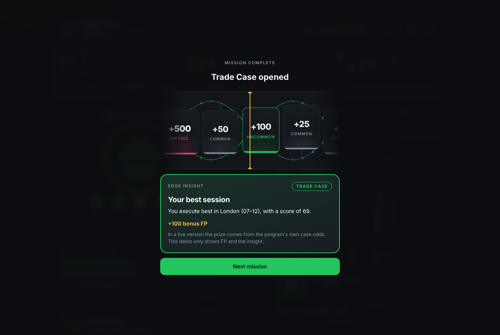

# EdgeDNA

**Trade clean. Crack cases.**
Training that turns good trades into habit, built for the [MyFundedPerps Builders Program](https://myfundedperpetuals.com/builders).

EdgeDNA reads every trade, recognizes the setup behind it, grades only the execution, and turns good habits into a game: clean trades build your edge print, mistakes cost points, and finished missions open cases.

> Concept build. Not official MyFundedPerps software. Not financial advice, and no profit is promised.

**Live demo:** `https://<your-github-username>.github.io/edgedna/` (simulated data, works in any browser)


## What it does

- **Recognizes 11 trading styles from the candles before each entry.** Classic: Breakout, Break & retest, Range / S&R, Trend pullback, Mean reversion. ICT / SMC: Liquidity sweep / SFP, Order block, Fair value gap, Market structure shift. Indicators: VWAP play, EMA bounce / cross. Chasing and trading with no setup are tracked separately as behavior.
- **Grades execution, never the method.** Every trade gets a 0–100 score from five parts: setup, entry, risk, management and discipline, plus an automatic Plan check (setup, stop beyond structure, normal size).
- **Finds your edge and your leak.** The *Your DNA* tab shows the style you execute best and the one that costs you most, and the next mission is picked from that leak.
- **Missions without a clock.** A clean trade adds a step, a mistake takes one back and breaks one of three shields. Only three trades a day count, so there is no reward for overtrading. Patience missions reward waiting out a cool-down after a loss.
- **Cases.** Five steps open a Trade Case on a DNA reel. A sharp run opens a Jackpot Case. In a live version the prize would come from the program's own case odds.
- **Shareable trade cards.** Each trade gets an animated card showing grade and R, never dollar amounts, with a share link and copy image.




## How it uses the MyFundedPerps API (read-only)

| Data | Endpoint | Used for |
|---|---|---|
| Accounts and risk snapshot | `GET /v1/accounts`, `GET /v1/accounts/{account_id}` | Choosing the account, context for missions |
| Closed positions: side, size, entry and exit price, realized PnL, fees, funding, open and close time | `GET /v1/positions?status=closed` | One position = one graded trade |
| Fills: expected price vs fill price, fee | `GET /v1/fills?account_id=…` | Entry slippage |
| Quote before entry | `GET /v1/markets/{market_id}/quote` | Expected slippage and fee |
| New activity in real time | Account stream (WebSocket) | Live grading (optional, `MFP_STREAM=1`) |
| Candles | Public market-data stream | Setup detection (next step) |

Pages are read with `limit=100` and `next_cursor` until `has_more` is false.

The API key lives only on the server (`server/.env`). It is never sent to the browser, as the program's rules require.

## Project layout

```
docs/index.html      The demo (GitHub Pages serves this folder)
server/src/engine.js Setup classifier, scoring and behavior flags (shared with the demo)
server/src/api.js    Read-only REST client
server/src/stream.js Account stream with resume (stream_id / last_seq)
server/src/trades.js Builds round-trip trades from fills
server/src/index.js  Small JSON server: /api/summary and /api/trades
```

## Run it

**Demo:** open `docs/index.html` in a browser. No setup.

**Server (Node 18+):**

```bash
cd server
npm install
cp .env.example .env    # leave MFP_API_KEY empty to run in demo mode
npm start               # then open http://localhost:8787/api/summary
```

With a key in `.env` the server reads your closed positions and fills and serves a summary: trades, win rate, net PnL, fees, funding, average entry slippage, revenge and overtrading flags. Use a **read-only** key. Sandbox keys (`fp_test_…`, `MFP_ENV=sandbox`) need sandbox access, which comes with a challenge purchase. Live read-only keys (`fp_live_…`, `MFP_ENV=live`) work on your evaluation accounts.

## Status

- **v0.1, this version:** full interactive demo on simulated data. Server runs in demo mode, and with a read-only key builds trades from closed positions and fills.
- **Next:** feed real candles from the market-data stream into the classifier, connect the demo to the server, test end to end on the sandbox.

## License

MIT
