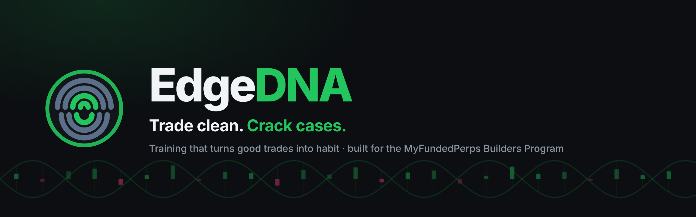
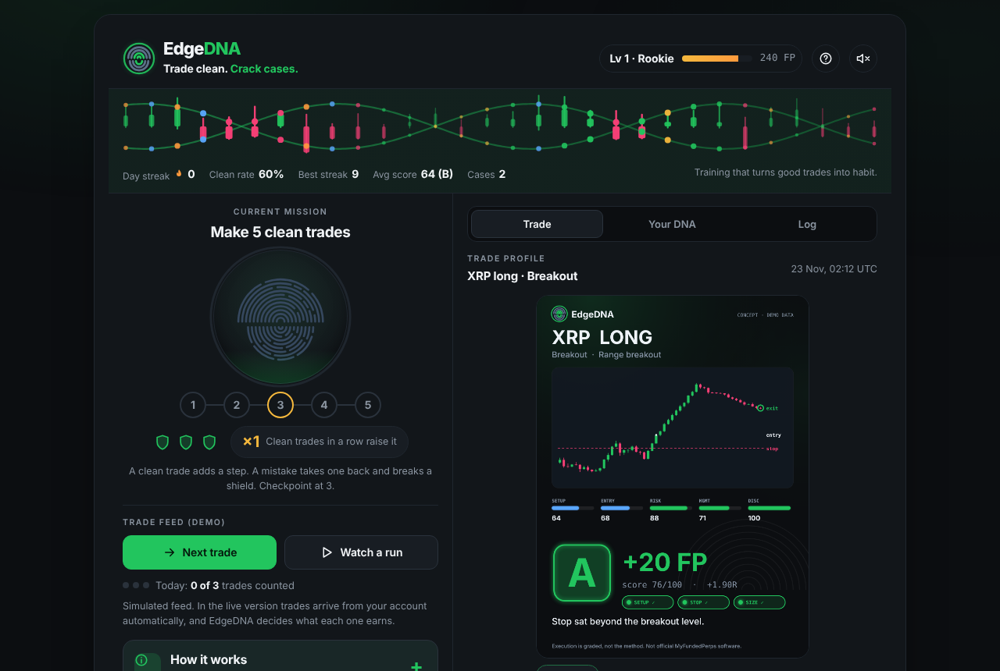
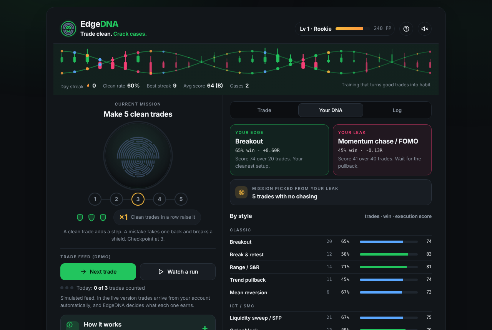

<p align="center">
  <a href="https://chairon999.github.io/edgedna/"></a>
</p>

<p align="center">
  <a href="https://chairon999.github.io/edgedna/"></a>
</p>

<p align="center">
  <a href="https://chairon999.github.io/edgedna/"><b>chairon999.github.io/edgedna</b></a> · runs in any browser · simulated data · press <b>Watch a run</b> to see a full mission in 30 seconds
</p>

EdgeDNA reads every trade, recognizes the setup behind it, grades only the execution, and turns good habits into a game: clean trades build your edge print, mistakes cost points, and finished missions open cases.

> Concept build for the [MyFundedPerps Builders Program](https://myfundedperpetuals.com/builders). Not official MyFundedPerps software. Not financial advice, and no profit is promised.



## What it does

- **Recognizes 11 trading styles from the candles before each entry.** Classic: Breakout, Break & retest, Range / S&R, Trend pullback, Mean reversion. ICT / SMC: Liquidity sweep / SFP, Order block, Fair value gap, Market structure shift. Indicators: VWAP play, EMA bounce / cross. Chasing and trading with no setup are tracked separately as behavior.
- **Grades execution, never the method.** Every trade gets a 0–100 score from five parts: setup, entry, risk, management and discipline, plus an automatic Plan check (setup, stop beyond structure, normal size).
- **Finds your edge and your leak.** The *Your DNA* tab shows the style you execute best and the one that costs you most, and the next mission is picked from that leak.
- **Missions without a clock.** A clean trade adds a step, a mistake takes one back and breaks one of three shields. Only three trades a day count, so there is no reward for overtrading. Patience missions reward waiting out a cool-down after a loss.
- **Cases.** Five steps open a Trade Case on a DNA reel. A sharp run opens a Jackpot Case. In a live version the prize would come from the program's own case odds.
- **Shareable trade cards.** Each trade gets an animated card showing grade and R, never dollar amounts, with a share link and copy image.




## Why it matters

**For traders.** Most evaluations are not lost on strategy but on execution: chasing, revenge entries, ignored stops, overtrading. A journal shows what happened. EdgeDNA changes what happens next, by naming the trader's edge and leak in plain words and turning the leak into the next mission.

**For MyFundedPerps.**
- **Better traders, fewer breaches.** Missions reward discipline, never volume: only three trades a day count, mistakes cost points, and patience is a mission of its own.
- **A reason to come back daily.** Streaks, shields, levels and cases give traders a short daily loop that is about quality, not more risk.
- **Built-in community growth.** Every trade becomes an animated card (grade and R, never dollar amounts) that traders want to share, and cases plug straight into the existing rewards.
- **Safe by design.** Read-only key on the server, no trading actions, no profit promises, and the method is never judged, only how it was executed.

## Design principles

1. **Grade the execution, never the method.** ICT, classic or indicator traders all get a fair score.
2. **Reward discipline, not volume.** A daily cap and patience missions remove the incentive to overtrade.
3. **Simple to read.** One mission, one print, one number per trade.
4. **Read-only and private.** No trading permissions, no dollar amounts on shared cards.

## Roadmap

- **v0.1 (now):** interactive demo, server skeleton, read-only REST integration.
- **v0.2:** sandbox end to end, real candles from the market-data stream feeding the classifier.
- **v1.0:** the demo connected to the server, live grading from the account stream, opt-in sharing and a first group of real users.

## How it uses the MyFundedPerps API (read-only)

| Data | Endpoint | Used for |
|---|---|---|
| Accounts and risk snapshot | `GET /v1/accounts`, `GET /v1/accounts/{account_id}` | Choosing the account, context for missions |
| Closed positions: side, size, entry and exit price, realized PnL, fees, funding, open and close time | `GET /v1/positions?status=closed` | One position = one graded trade |
| Fills: expected price vs fill price, fee | `GET /v1/fills?account_id=…` | Entry slippage |
| Quote before entry | `GET /v1/markets/{market_id}/quote` | Expected slippage and fee |
| New activity in real time | Account stream (WebSocket) | Live grading (optional, `MFP_STREAM=1`) |
| Candles | Public market-data stream | Setup detection (next step) |

Pages are read with `limit=100` and `next_cursor` until `has_more` is false.

The API key lives only on the server (`server/.env`). It is never sent to the browser, as the program's rules require.

## Project layout

```
docs/index.html      The demo (GitHub Pages serves this folder)
server/src/engine.js Setup classifier, scoring and behavior flags (shared with the demo)
server/src/api.js    Read-only REST client
server/src/stream.js Account stream with resume (stream_id / last_seq)
server/src/trades.js Builds round-trip trades from fills
server/src/index.js  Small JSON server: /api/summary and /api/trades
```

## Run it

**Demo:** open `docs/index.html` in a browser. No setup.

**Server (Node 18+):**

```bash
cd server
npm install
cp .env.example .env    # leave MFP_API_KEY empty to run in demo mode
npm start               # then open http://localhost:8787/api/summary
```

With a key in `.env` the server reads your closed positions and fills and serves a summary: trades, win rate, net PnL, fees, funding, average entry slippage, revenge and overtrading flags. Use a **read-only** key. Sandbox keys (`fp_test_…`, `MFP_ENV=sandbox`) need sandbox access, which comes with a challenge purchase. Live read-only keys (`fp_live_…`, `MFP_ENV=live`) work on your evaluation accounts.

## Status

- **v0.1, this version:** full interactive demo on simulated data. Server runs in demo mode, and with a read-only key builds trades from closed positions and fills.
- **Next:** feed real candles from the market-data stream into the classifier, connect the demo to the server, test end to end on the sandbox.

## License

MIT
